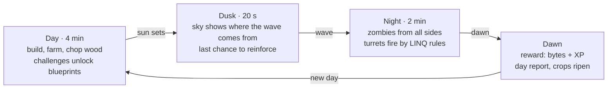

# Survive.cs — Game Design Document

Status: design approved for prototyping. Last updated: 2026-11-03.

## 1. Idea

Survive.cs is a single-player 2D survival game. Zombies come in endless waves; the player builds a base, grows a farm and levels up a hero. Every powerful action is unlocked by solving a C# challenge.

**Audience:** school students and university students learning C# from zero to Junior level. First audience: IT Academy STEP groups and school students.

**Core idea in one sentence:** knowledge is power in the game. If you know `for`, you build ten walls with one command. If you know LINQ, your turret shoots the most dangerous zombie first. If you know JSON, you open the supply drop that came from a helicopter.

**Name:** `Survive.cs` reads like a C# file ("the survival code") and also says what the game is about. Alternatives: Null Siege, Byte Bunker, Zombie.Compile().

**Principles:**

1. **No code execution.** Every challenge is deterministic: choose, assemble, or find the bug. No server, no sandbox.
2. **Learning lives inside the game, not beside it.** A question is not a "quiz popup", it is a "code terminal": a solved command immediately becomes a wall, a turret or a harvest.
3. **A mistake teaches, it does not punish.** A wrong answer comes with an explanation, the question comes back later, and the only cost is time.
4. **Every session leaves something behind.** The base, the hero and the knowledge tree persist, so even a 15-minute session is progress.
5. **The game has to be fun on its own.** Fighting, building and farming must be enjoyable even without challenges. Learning makes them faster and stronger.

## 2. Game loop

The game runs on a day/night cycle: building, farming and learning by day, defending by night. One day+night is about 6 minutes (4 min day, 2 min night), so a lecture or an evening at home fits 2–3 cycles comfortably.



Night is the only phase with time pressure; the other three prepare for it.

- **Day (4 min).** Zombies do not attack. The player explores, mines, gathers wood and stone, builds and upgrades. Every building and upgrade is made from a **blueprint**, and a blueprint is unlocked by a C# challenge (§5).
- **Dusk (20 s).** The sky shows when night comes and which side the wave will come from. Last chance to reinforce a wall.
- **Night (2 min).** Zombies come from every side. Turrets shoot by their programs; the player fights with the hero. During combat there are quick challenges: a "quick command" (5–8 seconds) gives a reload, a bomb or a wall repair.
- **Dawn.** Summary: zombies killed, buildings kept, night reward (bytes and XP). Farm crops ripen.

**If the hero falls,** the base is not destroyed: the hero wakes up at home in the morning and loses half of the night reward. If zombies destroy the core building ("Server"), the run ends. The record is the night you reached; the base-building progress and the knowledge tree stay.

## 3. World and view

The view is 3/4 top-down ("top-down oblique", like Stardew Valley or classic Zelda): the map is seen from above, but objects show their front side, so height and volume are visible.

**How the depth effect works:**

- The map is a square grid (32×32 px tiles). The floor is drawn from above; walls and buildings have a "roof" and a front face (height 0.5–1.5 tiles).
- **Y-sorting:** every object is drawn by the Y coordinate of its feet. A zombie behind a wall is hidden; in front of it, it shows on top.
- Every character and building has a soft elliptical shadow that "grounds" it. At night torches and turret lights create soft radial lighting.
- Height is mechanically irrelevant: collision and shooting are calculated on the 2D grid. The 3D effect is drawing only, which keeps the physics simple.

**Map:** 64×64 tiles with the house ("Server") in the middle. The map opens in rings: at the start a safe 20×20 zone is visible, the rest is fog. To clear fog the player builds a "watchtower torch"; a new zone gives new resources (stone, iron, ruins). Zombies come from "sockets" (spawns) at the map edges, and their number grows night by night.

**Camera:** follows the hero smoothly, three zoom levels. In build mode the camera pulls back so the whole base and the grid are visible. At night, arrows at the screen edge show where off-screen zombies are coming from.

**Controls:** keyboard (WASD + mouse) and touch (virtual joystick). Shooting auto-targets the nearest zombie, so the player's attention goes to tactics and challenges, not to aiming.

## 4. Systems

Five systems depend on each other: the farm gives food, food powers the hero, the hero and turrets protect the walls, and the walls protect the farm.

### Building

| Building | Levels | What it does |
| --- | --- | --- |
| Wall | wood → stone → iron → energy barrier | stops zombies, has HP |
| Door | wood → iron | lets the hero through, not zombies |
| Turret | three types, 5 levels | shoots automatically by its program |
| Trap | single use | stops a zombie for 3 seconds |
| Torch | one level | clears fog, lights the night |
| Storage | 3 levels | raises resource limits (the Dictionary lesson) |
| Radio station | single | receives JSON supply drops from the helicopter |
| Server (house) | 5 levels | the base core: if it falls, the run ends |

Building starts with a **blueprint**: to build the first of a type, the player solves a challenge on its topic. Building the second and later ones only costs resources. **Batch building** (e.g. 10 walls at once) is unlocked by a loop challenge: `for (int i = 0; i < 10; i++) Build(Wall, x + i, y);`.

### Turrets and weapons

- **Three turrets:** crossbow (fast, single target), cannon (area, slow), lightning (chain hit on several zombies).
- **A turret's program is LINQ.** At first a turret takes the nearest: `zombies.OrderBy(z => z.Distance).First()`. New rules unlock through challenges: "weak ones first so they don't slip through" `Where(z => z.Hp < 30)`, "boss first" `OrderByDescending(z => z.MaxHp)`. The player assembles the rule from blocks (like the Detective world in Bytefight Academy) and watches at night how it works.
- **The hero's weapons are an OOP hierarchy:** `abstract class Weapon` → `Pistol`, `Shotgun`, `Crossbow`, with an `IUpgradable` interface. A new weapon is crafted when the player assembles its class (the Robot Factory mechanic).

### Hero

- Stats: HP, speed, damage, build speed, harvest. Each is raised with XP.
- **Skill tree with three branches:** "Fighter" (shooting, crits), "Engineer" (turrets, walls), "Farmer" (harvest, automation).
- The hero is itself a class: their `Player` class grows with every new skill and is shown as code in the hero window. The student watches their character grow in code.

### Farm

- Plots (tiles) must be tilled, seeded and watered. Crops grow by days: three stages (`enum GrowthStage`).
- Crops: potato (food, HP), sunflower (bytes, for selling), "code flower" (rare, gives skill points).
- **Automation:** a watering robot is unlocked by a loop + condition challenge: `foreach (var plot in farm.Where(p => p.IsDry)) plot.Water();`. The student sees directly how code saves time.

### Zombies

| Zombie | Behaviour | Appears from |
| --- | --- | --- |
| Walker | slow, medium HP | night 1 |
| Runner | fast, weak | night 3 |
| Tank | slow, very strong, breaks walls | night 5 |
| Flying "Bug" | flies over walls | night 7 |
| NullReference | invisible until a torch lights it | night 10 |
| Boss (StackOverflow) | huge; on death splits into two smaller ones (recursion!) | every 5th night |

Zombie names come from well-known C# errors. On the first appearance of each new type, a short card explains the real error: "A NullReferenceException happens when you use an object that is null…".

## 5. Learning mechanics

Every challenge is solved in a **code terminal** and checked against a known answer, without running code. There are nine types, so learning never gets monotonous.

| Type | What the player does | Example | Where it is used |
| --- | --- | --- | --- |
| Question | picks 1 of 3–4 options | "Which type stores a whole number?" | quick commands at night |
| What does it print? | predicts the output | `Console.WriteLine(7 / 2);` | radio cipher |
| Find the bug | taps the buggy line, then picks the fix | `i <= arr.Length` | repairing a "broken" turret |
| Order the lines | arranges shuffled lines in the right order | `try` / `catch` / `finally` blocks | building blueprint |
| Fill the blank | picks the missing token | `foreach (var z ___ zombies)` | building upgrade |
| Assemble from blocks | builds a command from blocks; the result appears on the map immediately | `for` + `Build(Wall, x + i, y)` | batch building, farm robot |
| Assemble LINQ | builds a chain from fields and operators | `zombies.Where(…).OrderBy(…)` | turret program |
| Assemble a class | adds members and inheritance; a "compiler" checks it | `class Shotgun : Weapon` | new weapon |
| Fix the JSON | finds and fixes the error in JSON | key without quotes, trailing comma | opening a supply drop |
| Debugger | steps through code and predicts a variable's value | "What is `sum` on the 3rd iteration?" | boss night |

**Tiers and rewards:**

- Questions come in three tiers: bronze (basics), silver (application) and gold (depth, common pitfalls). The harder, the more bytes.
- A correct answer gives bytes and XP. The unlocked command stays open forever.

**On a mistake:**

- An explanation shows why the chosen answer is wrong (every wrong option has its own explanation, as in the Arena).
- The question enters a "review queue" and comes back after 1, 3 and 7 days (spaced repetition). Answer it correctly and you get a double reward.
- The only cost is time. No resources are lost, so the child is not afraid to try.

**Mastery:** every topic has a mastery score of 0–100% based on the last 10 answers. At 80% the topic is "complete" and the next topics open. Questions from completed topics still come back occasionally so they are not forgotten.

## 6. Full C# curriculum

The curriculum is split into 14 chapters (~40 topics, ~400 challenges) and is the game's tech tree. Each chapter opens new buildings and skills, so the order of learning is a game benefit, not an obligation.

```mermaid
flowchart LR
    subgraph Basics["Basics · 1–5"]
        C1["1 Fundamentals<br/>wooden wall"] --> C2["2 Conditions<br/>door"] --> C3["3 Loops<br/>batch build"] --> C4["4 Methods<br/>skills"] --> C5["5 Arrays<br/>new zones"]
    end
    subgraph Structure["Structure · 6–9"]
        C6["6 Collections<br/>storage, inventory"] --> C7["7 OOP<br/>hero class"] --> C8["8 Advanced OOP<br/>weapon tree"] --> C9["9 Errors<br/>generator"]
    end
    subgraph Pro["Professional · 10–14"]
        C10["10 LINQ<br/>turret AI"] --> C11["11 JSON<br/>radio station"] --> C12["12 Delegates<br/>traps"] --> C13["13 Async<br/>drone"] --> C14["14 CRUD and API<br/>trading post"]
    end
    C5 --> C6
    C9 --> C10
```



Chapters open in order; the bottom line of each box is what the chapter gives in the game.

| Chapter | Topics | What it unlocks in the game |
| --- | --- | --- |
| 1. Fundamentals | variables, types (int, double, decimal, bool, char, string), operators, conversion, `const`, string interpolation | wooden wall, storage, potato |
| 2. Conditions | `if`/`else`, logical operators, `switch`, switch expression, `?:`, `??` | door, crossbow turret, night warning |
| 3. Loops | `for`, `while`, `do-while`, `foreach`, `break`, `continue`, nested loops | batch building (10 walls), watering robot |
| 4. Methods | parameters, `return`, overloads, `ref`/`out`, default parameters, recursion | skills, cannon, StackOverflow boss |
| 5. Arrays and strings | arrays, 2D arrays (the map!), `string` methods, `StringBuilder` | revealing the map, radio cipher |
| 6. Collections | `List<T>`, `Dictionary<K,V>`, `Queue<T>`, `Stack<T>`, `HashSet<T>` | inventory (Dictionary), wave order (Queue), undo (Stack) |
| 7. OOP basics | class, object, property, constructor, encapsulation, `static` | hero class, weapon workshop |
| 8. Advanced OOP | inheritance, `abstract`, `virtual`/`override`, interfaces, polymorphism, `enum`, `record`, `struct` | weapon hierarchy, zombie types, `GrowthStage` |
| 9. Errors | `try`/`catch`/`finally`, exception types, `throw`, null safety (`?.`, `??`, nullable) | generator, NullReference zombie |
| 10. LINQ | `Where`, `Select`, `OrderBy`, `First`/`FirstOrDefault`, `Any`/`All`, `Count`, `Sum`/`Max`, `GroupBy`, `Take`/`Skip` | turret programs, storage analysis |
| 11. JSON and files | JSON syntax, types, nested objects, `JsonSerializer.Serialize`/`Deserialize`, `[JsonPropertyName]` | radio station, save file |
| 12. Delegates and events | lambda, `Func`/`Action`, `event`, generics | traps (`OnZombieEnter`), triggers |
| 13. Async | `async`/`await`, `Task`, `Task.Delay`, parallel work | drone that gathers resources in the background |
| 14. Final chapter: CRUD and API | REST methods, status codes, the idea of EF Core | "trading post": trading with other survivors through an API |

**Pace:** the full curriculum is roughly 60–80 nights (20–30 hours of play). Endless waves continue after that, with mixed challenges from every chapter.

**For the lecturer:** a student opens the next chapter only after mastering the previous one. A lecturer may also be able to "lock" chapters for their group by the lectures covered so far (open question in §11).

## 7. Economy and balance

Resources come from two sources: the world (wood, stone, food) and knowledge (bytes). Balance is set so that survival is possible without learning, but slow.

| Resource | From | For |
| --- | --- | --- |
| Wood | chopping trees | walls, doors, farm |
| Stone | rocks, new zones | stone walls, turrets |
| Iron | ruins, radio supply drops | iron walls, weapons |
| Food | farm | restoring HP, the hero's daily "energy" |
| Bytes | challenges, zombies, sunflowers | blueprints, upgrades, skills |
| XP | correct answers, surviving a night | hero level |

**Energy:** every day action (chopping, building, watering) costs energy; food refills it. Automating commands (loops, robots) saves energy, so the child feels for themselves why code is needed.

**Endless waves.** Night difficulty grows with a formula (n = night number):

```
zombies(n) = 6 + 3n + floor(0.15 · n²)
hp(n)      = hp₀ · (1 + 0.08 · n)
```

The system compares the base's total "power" (walls + turrets + hero) with the wave's power. If the base falls far behind, the wave gets weaker ("rubber banding"), so a weaker student also survives and keeps learning.

**The price of knowledge:** a bronze challenge is worth 10 bytes, silver 25, gold 60. A new building level costs 50–300 bytes. A student solves 4–6 challenges per day on average, i.e. ~150 bytes: enough for one new building. These numbers are a starting point and will be tuned on the prototype.

**Why it is satisfying:** after every night a "day report" shows which turret killed how many zombies and which wall broke. The child sees that their LINQ rule really defended the base.

## 8. Visuals, sound and interface

Style: "cozy apocalypse": soft colours, round shapes, no gore. Zombies are funny rather than scary (green clumsy creatures confused by everything), so it works for younger children too.

**Colours:**

| Role | Day | Night |
| --- | --- | --- |
| Grass | `#8DBF6A` | `#2E4A3F` |
| Floor / path | `#D9C49A` | `#4A4538` |
| Wood | `#B07A45` | `#5C4430` |
| Stone | `#A7ADB2` | `#4D555B` |
| Zombie | `#7FB069` | `#9BE07A` (glows faintly in the dark) |
| Code terminal | `#18242A` background, `#7FC8B8` keywords | same |

When night falls the colours shift gradually to the night palette; each torch and turret creates a circle of warm light.

**Screen layout:**

- **Top bar:** day cycle (sun/moon + time), resources, hero HP and energy.
- **Bottom bar:** build palette (1–8 buttons); a locked blueprint shows a lock and its topic ("To unlock: loops").
- **Right panel (slide-out):** the code terminal for challenges. By day it takes half the screen and the game pauses; at night it is a small quick card and the game keeps running.
- **Bottom left:** mini-map with spawns and the base outline.
- **Knowledge tree** is a separate screen (Tab): chapters, mastery % and what each unlocks.

**Motion and effects:** a building rises from below with "compile" particles, a zombie breaks into pixels on death, turret shots are light sparks. The screen shakes only on boss hits. `prefers-reduced-motion` calms everything down.

**Sound:** effects synthesised with Web Audio (as in the Arena): a build "knock", a two-note chime for a correct answer, a quiet zombie grumble. Day music is calm acoustic, night music more rhythmic and tense. Both can be turned off.

## 9. Tech

The prototype is a single HTML file on Canvas 2D, with no libraries and no server (like the Arena and the Academy). The full version can be an Angular app or a module of the Bytefight platform, while the game core stays the same TypeScript.

**Engine parts:**

- **Fixed timestep** (logic at 60 ticks per second, rendering on `requestAnimationFrame`): the same behaviour on slow and fast computers.
- **Map:** 2D array `tiles[y][x]`. Zombie pathing uses a flow field (BFS from the house), recalculated only after building. That way 100+ zombies move fast.
- **Rendering:** floor first on an offscreen canvas, then objects sorted by Y, and finally the lighting layer (night colour + radial "holes"). At first graphics are drawn in code; later replaced with sprite sheets.
- **Challenges are data, not code:** all of them live in one JSON bank, so adding a new challenge does not change the game.

**Challenge format (example: "order the lines"):**

```json
{
  "id": "loops-build-row-01",
  "chapter": 3,
  "topic": "for",
  "tier": "silver",
  "type": "order",
  "unlocks": "batch-build",
  "prompt": "Arrange the lines so the robot builds 5 walls in one row.",
  "lines": [
    "for (int i = 0; i < 5; i++)",
    "{",
    "    Build(Wall, x + i, y);",
    "}"
  ],
  "distractors": ["    Build(Wall, x, y + i);"],
  "explain": "x + i moves one cell to the right each iteration, so the walls line up horizontally.",
  "why": { "distractor-0": "y + i would build the walls vertically." }
}
```

Other types have their own fields: `options` + `correct` (question), `code` + `bugLine` (find the bug), `blanks` (fill the blank), `steps` + `expected` (LINQ). One schema, and a validation script checks the bank on every change.

**Saving:**

- The session saves automatically after every night. In the prototype: browser storage; on the platform: the account.
- The save file is shown to the student as JSON. In chapter 11 reading and fixing the JSON of their own base becomes a challenge.

## 10. Build phases

Each phase ends with a playable version. The first phase tests whether the game is fun even without learning, so it must be tried on children early.

1. **Vertical slice (1–2 weeks).** Map, 3/4 view, hero, wooden wall, one turret, the walker zombie, day/night, 40 challenges from chapters 1–2, two types (question, fill the blank).
    - Done when: 5 children play for 10 minutes and want the next night.
2. **Farm and hero.** Crops, energy, skill tree, XP. Chapters 3–4 (loops, methods), the assemble-from-blocks type, batch building.
    - Done when: a child discovers on their own that building with a loop saves energy.
3. **Collections and OOP.** Chapters 5–8, storage (Dictionary), weapon classes, the class builder and "compiler", four zombie types.
4. **LINQ turrets.** Chapter 10, the turret program builder, the day report, the debugger type.
5. **JSON, errors, async.** Chapters 9, 11 and 13, radio station, generator, drone, bosses.
6. **Content and balance.** Bank up to 400 challenges, spaced repetition, the mastery board, map zones.
7. **Move to the platform.** Bytefight accounts, progress on the server, a lecturer board: who is on which chapter and which topic is hard.

**For Claude Code:** this document goes into the repo as `docs/SURVIVE.md`. Each phase needs its own plan and approval before code, as in Bytefight's CLAUDE.md.

## 11. Risks and open questions

| Risk | Effect | Mitigation |
| --- | --- | --- |
| Challenges interrupt the game | the game feels like homework | by day the player chooses when to open the terminal; night cards are optional |
| A weak student cannot survive | loses motivation | rubber banding, the hero does not lose the base, bronze questions are accessible to everyone |
| "Guessing" without reading | no learning happens | shuffled options, a different question on the same topic after a mistake, a fast run of mistakes locks the terminal for a few seconds |
| Writing 400 challenges is a lot of work | content falls behind | templates per type, reuse of the Academy and Arena 81+ questions, a validation script |
| Many zombies on a weak computer | the game stutters | flow field, an on-screen zombie limit (draw up to 150), offscreen floor |

**Open questions:**

- [ ] Name: Survive.cs or something else?
- [ ] Language: menus and explanations in Georgian, code in English. Do we also need an English version?
- [ ] Should a lecturer be able to lock or open chapters for a group?
- [ ] Build the prototype as an artifact, or directly in the Bytefight monorepo?
- [ ] When a run is lost (the Server falls), what stays: only the knowledge tree, or the hero level too?